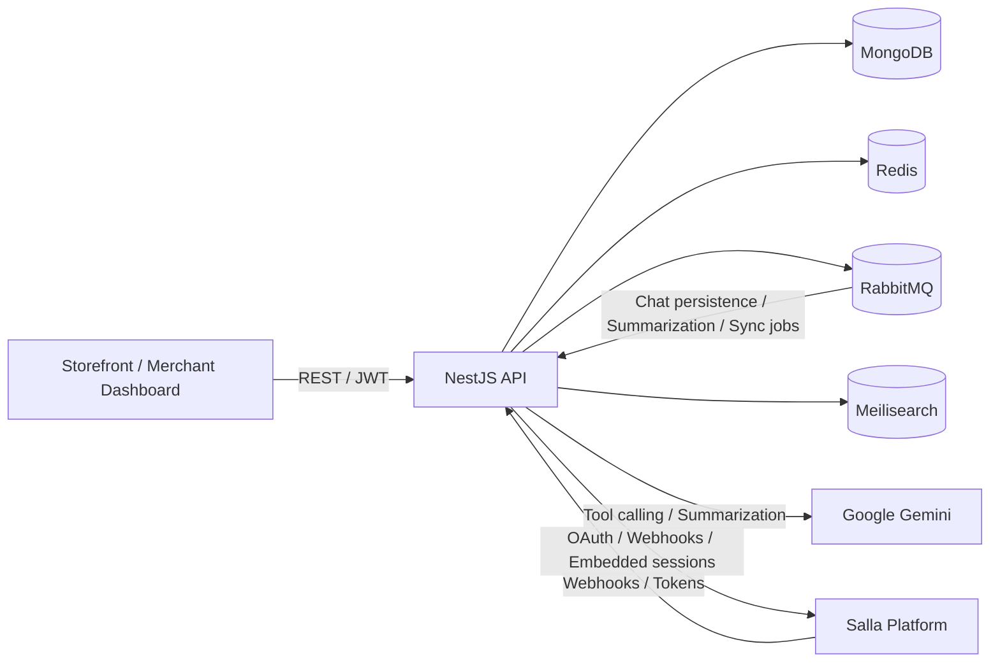
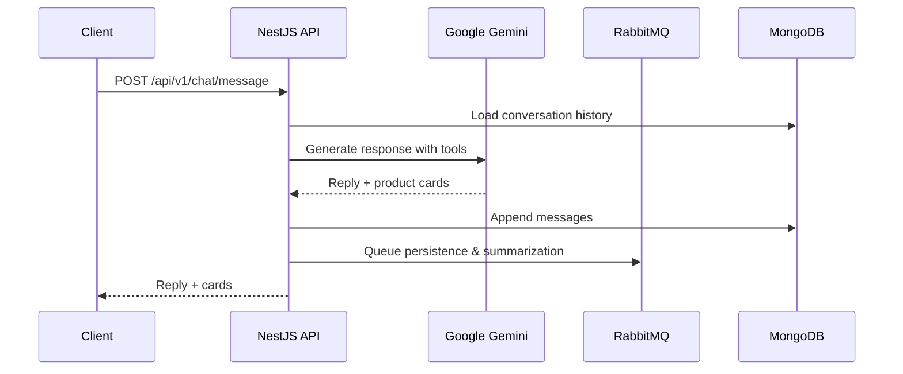

# Lary — AI Shopping Assistant & Insights for E-commerce Platforms

<p>
  <strong>Enterprise-grade backend for conversational commerce, product discovery, and merchant customer-insights.</strong>
</p>

<p>
  
  
  
  
  
  
  
  
  
  
</p>

## Project Overview

Lary is a backend platform that powers an AI shopping assistant inside e-commerce stores. Customers discover products through natural language, ask follow-up questions, and add items to their cart directly from the conversation. Merchants get a dashboard that turns those interactions into actionable insights: product demand, potential cart value, missed opportunities, and conversion attribution.

The platform is built with NestJS and integrates MongoDB, Redis, RabbitMQ, Meilisearch, and Google Gemini. It currently ships a full Salla integration (OAuth, webhooks, embedded sessions, token refresh) and is structured to support additional e-commerce platforms.

## Key Features

- **Conversational product discovery** — natural-language search with attribute extraction (color, size, price, category, use case).
- **Gemini-powered assistant** — tool/function calling, multi-turn context, conversation summarization, and Gulf/Saudi dialect support.
- **Add to cart from chat** — real-time stock and price verification before adding items.
- **Hybrid catalog search** — Meilisearch for fast retrieval with cached catalog data and live verification at cart time.
- **Merchant dashboard** — overview metrics, chat history, billing/plan info, potential cart value, missed demand, and conversion tracking.
- **Async processing** — RabbitMQ queues for chat persistence, summarization, and product synchronization.
- **Security** — JWT access tokens, refresh-token rotation with reuse detection, RBAC, AES-256-GCM token encryption, HMAC webhook verification.
- **Production readiness** — Redis-backed rate limiting, health/readiness probes, structured logging, Docker Compose, Nginx, and CI/CD with rollback.

## API Documentation

The backend exposes **13 REST endpoints** across 5 controllers. All routes are versioned under `/api/v1` except health probes.

### Endpoint Groups

| Group | Endpoints |
|---|---|
| Health | `GET /health/liveness`, `GET /health/readiness` |
| Chat | `POST /api/v1/chat/message` |
| Dashboard | `GET /api/v1/dashboard/billing`, `GET /api/v1/dashboard/overview`, `GET /api/v1/dashboard/chat`, `GET /api/v1/dashboard/chat/:conversationId` |
| Assistant Settings | `GET /api/v1/assistant-settings/public/:merchantId`, `GET /api/v1/assistant-settings/me`, `PATCH /api/v1/assistant-settings/me` |
| Salla Integration | `POST /api/v1/integrations/salla/webhook`, `GET /api/v1/integrations/salla/status`, `POST /api/v1/integrations/salla/embedded/session` |

### Resources

- Swagger / Scalar docs: `http://localhost:3000/api/v1/docs` (configurable via `SWAGGER_PATH`)
- Base URL: `http://localhost:3000/api/v1`

## System Architecture




## Architecture Notes

- **Modular design:** Each domain (chat, dashboard, products, stores, subscriptions, integrations) is isolated in its own NestJS module with dedicated services, repositories, and schemas.
- **Event-driven flows:** Chat turns, summarization, and product sync are published to RabbitMQ and consumed asynchronously to keep API latency low.
- **Hybrid data strategy:** Meilisearch provides fast product retrieval from cached catalog data, while add-to-cart performs real-time stock and price verification.
- **Security boundaries:** JWT access tokens, refresh-token rotation with reuse detection, AES-256-GCM integration-token encryption, and HMAC-verified webhooks.

### Chat Request Flow



## Project Structure

```text
src
├── common
├── config
├── infrastructure
│   ├── cache
│   ├── database
│   ├── encryption
│   ├── jwt-auth
│   ├── logger
│   ├── meilisearch
│   ├── rabbitmq
│   ├── redis
│   └── swagger
├── modules
│   ├── assistant-settings
│   ├── chat
│   ├── dashboard
│   ├── health
│   ├── integrations
│   │   └── salla
│   ├── products
│   ├── stores
│   ├── subscriptions
│   └── users
├── shared
└── main.ts
```

## Tech Stack

| Category | Technology |
|---|---|
| Runtime | Node.js 20+ |
| Framework | NestJS 11 |
| Language | TypeScript 5.x |
| Database | MongoDB + Mongoose |
| Cache | Redis + ioredis |
| Messaging | RabbitMQ |
| Search | Meilisearch |
| AI | Google Gemini |
| Auth | JWT + Passport |
| Security | Helmet, bcrypt, AES-256-GCM |
| API Docs | Swagger + Scalar |
| Logging | Winston |
| Deployment | Docker, Nginx, GitHub Actions |

## Getting Started

### Prerequisites

- Node.js >= 20.x
- npm >= 10.x
- MongoDB instance
- Redis instance
- RabbitMQ instance
- Meilisearch instance
- Google Gemini API key
- Salla app credentials (for integration features)

### Installation

```bash
git clone https://github.com/ashrafsamir/lary.git
cd lary
npm install
cp .env.example .env
```

Configure the variables in `.env` (see `.env.example` for the full list).

### Development

```bash
npm run start:dev
```

### Production

```bash
npm run build
npm run start:prod
```

### Health Check

```bash
GET /health/liveness
GET /health/readiness
```

### Available Scripts

| Command | Description |
|---|---|
| `npm run build` | Build the application |
| `npm run start:dev` | Start in development mode |
| `npm run start:prod` | Start in production mode |
| `npm run lint` | Run ESLint |
| `npm run typecheck` | Run TypeScript type checking |
| `npm run validate` | Run lint + typecheck |

## Deployment

The project ships with a production Docker Compose setup and Nginx configuration.

```bash
docker compose -f docker-compose.prod.yml up -d
```

CI/CD is handled via GitHub Actions: images are built and pushed to GHCR, then deployed over SSH with automatic rollback on failure.

## Roadmap

- Add support for additional e-commerce platforms (e.g., Shopify).
- Expand automated test coverage.
- Introduce demand forecasting and automated inventory recommendations.

## Contributing

Contributions are welcome. Please open an issue or pull request following the repository's contribution guidelines.

## License

Distributed under the MIT License. See `LICENSE` for details.
